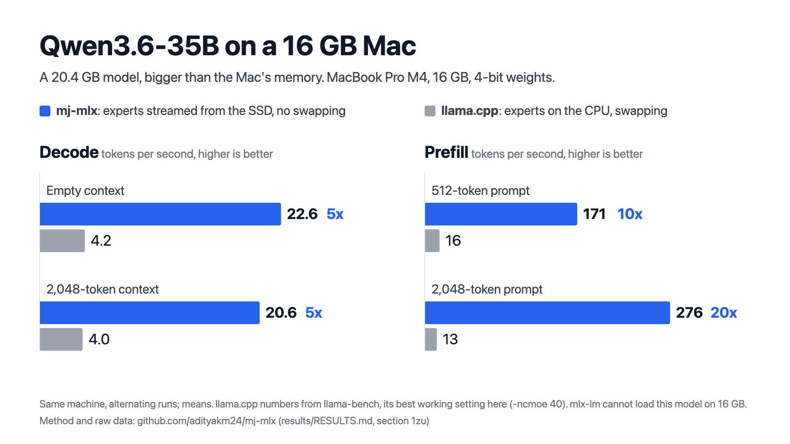

# mj-mlx

Fast, exact inference for mixture-of-experts (MoE) language models on Apple silicon, built on
[MLX](https://github.com/ml-explore/mlx). It runs MoE models that fit in a Mac's memory, and many that don't, by
streaming experts from the SSD. Every speed, quality and energy claim below was measured against the other Mac engines
on the same machine; the method and raw files are in this repository.

> **Beta (0.1.0.dev0).** Built from source only; not on PyPI. Tested on one Mac (M4 MacBook Pro, 16 GB) with
> Python 3.11. The Python API is the engine's own and will change before 1.0; there is no server or CLI yet
> ([roadmap](ROADMAP.md)). Bug reports and results from other Macs are very welcome.



## Why

- **Bigger than RAM, without swapping.** Qwen3.6-35B-A3B (20.4 GB) decodes at about 22 tok/s on a 16 GB Mac, with no
  swap growth. llama.cpp on the same Mac runs it at about 4 tok/s while swapping, and mlx-lm cannot load it.
- **Fast without losing quality.** "Exact" means the checkpoint's own precision. On gpt-oss-20b, the exact path ties
  llama.cpp in decode; at llama.cpp's own (8-bit) attention precision it is 8-9% faster.
- **Less energy per token.** Whole-machine energy per decoded token, above idle: 30% below llama.cpp on OLMoE (equal
  to mlx-lm).

## Measured results

One M4 MacBook Pro, 16 GB. Engines alternate (ABAB) on the same machine; numbers are means, with 95% confidence
intervals in the source sections; blocks where swap grew are flagged and left out unless said. Each row names its
section of [`results/RESULTS.md`](results/RESULTS.md).

| Model | Result | Source |
| --- | --- | --- |
| Qwen3.6-35B-A3B 4-bit (20.4 GB, bigger than RAM) | decode 22.6 tok/s vs llama.cpp 4.2; at a 2048-token context 20.6 vs 4.0. Prefill 171 vs 16 tok/s (512 tokens), 276 vs 13 (2048). Our blocks are clean; every llama.cpp block swapped (its best working setting here keeps experts on the CPU, `-ncmoe 40`). mlx-lm cannot load it on 16 GB | 1zu, 1zs, 1zb |
| gpt-oss-20b, exact (bf16 attention, MXFP4 experts) | decode 37.00 tok/s, tied with llama.cpp (37.04); at a 2048-token context 35.73 vs 35.29. Ollama 34.75 | 1zu |
| gpt-oss-20b, 8-bit attention (the precision of llama.cpp's GGUF) | decode 40.16 tok/s vs llama.cpp 37.04 (+8.4%); at a 2048-token context 38.57 vs 35.29 (+9.3%) | 1zu |
| gpt-oss-20b, long-context retrieval in chat format | 36 / 36 correct at 4k, 8k and 16k. llama.cpp 12 / 12, 12 / 12, and 11 / 12 at 16k, where it needs a 128-token ubatch to fit | 1zx |
| DeepSeek-V2-Lite 4-bit, long context | runs to 32k (16k: retrieval 9 / 12). llama.cpp does not fit at 8k under macOS's default GPU memory limit at any batch size, and swaps when partly offloaded | 1zp, 1zx, 1zi, 1zzb |
| DeepSeek-V2-Lite 4-bit, 2048-token context | decode 52.24 tok/s vs vllm-mlx 49.64, llama.cpp 41.02, Ollama 35.01 | 1zh |
| OLMoE-1B-7B 4-bit | whole-machine energy per decoded token above idle 171 mJ vs llama.cpp 246 (30% less), mlx-lm 169. Decode at a 2048-token context 99.79 tok/s, tied with vllm-mlx (98.91) | 1zw, 1zh |
| gpt-oss-20b, energy | 23% less whole-machine energy per token than llama.cpp with 8-bit attention (601 vs 783 mJ). **Provisional:** to be re-run on a quiet machine | 1zw |

**Quality.** On the same weights, the engine scores the same as mlx-lm on MMLU (1,140 questions) and GSM8K (250
problems) subsets (RESULTS 1zr). On gpt-oss-20b, our exact path is closer to a float32 reference than mlx-lm's bf16
path (mean KL 0.0077 vs 0.0131 over 8,033 positions; 1zz). Every model family is also tested token for token against
transformers on tiny checkpoints.

**Where it is behind today**, measured the same way:

- **gpt-oss-20b prefill:** llama.cpp is 4.5-6.9% faster than the exact path, 2.5-4.3% faster than 8-bit attention
  (1zu).
- **Short-context decode on small models:** DeepSeek-V2-Lite at a 1-token context, 61.00 tok/s vs vllm-mlx 66.02
  (1zh).
- **Memory on small models:** OLMoE peaks at 7.2 GB vs 6.6 GB in mlx-lm (1zo).
- **The first load of a model is slow:** expert stores and prepared weights are written once (gpt-oss-20b: 7.7-9.7 s
  to the first token the first time). After that, gpt-oss-20b reaches its first token in about 2.5 s, level with
  llama.cpp's 3.1 s (one round each, machine not quiet; 1zzc).

## Supported models

MoE models only; for dense models use [mlx-lm](https://github.com/ml-explore/mlx-lm).

- **gpt-oss** (20B): its own tuned model class. MXFP4 experts, bf16 or 8-bit attention, EAGLE-3 speculative decoding.
- **Qwen3.5 / Qwen3.6 MoE**: hybrid Gated DeltaNet plus full attention, MTP speculative decoding.
- **The general MoE model**: Mixtral, Qwen2-MoE, Qwen3-MoE, OLMoE, DeepSeek-V2 / V3 (MLA) and GLM-4-MoE. Hugging Face
  bf16 or mlx-community quantized checkpoints.

Where the experts live is picked from the model's size and the Mac's free memory: resident, memory-mapped, or
streamed from the SSD. Details: [docs/models.md](docs/models.md).

## Quick start

Requirements: a Mac with Apple silicon, the Xcode command-line tools, Python 3.11 and a Rust toolchain
([rustup](https://rustup.rs)). Full steps: [docs/install.md](docs/install.md).

```bash
git clone https://github.com/adityakm24/mj-mlx.git && cd mj-mlx
```

```bash
python3.11 -m venv .venv && .venv/bin/pip install "maturin>=1.7,<2" transformers huggingface_hub jinja2
```

```bash
.venv/bin/maturin develop --release
```

Download a small MoE model (3.6 GB) and run it:

```bash
.venv/bin/hf download mlx-community/OLMoE-1B-7B-0125-Instruct-4bit --local-dir models/olmoe
```

```python
import mj_mlx                                   # import before mlx: sets MLX's buffer and residency settings
from transformers import AutoTokenizer

path = "models/olmoe"
tok = AutoTokenizer.from_pretrained(path)
model = mj_mlx.load_model(path, placement="auto")     # resident, mapped or streamed experts, by free memory
engine = mj_mlx.Engine(model=model, overlap=True)

text = tok.apply_chat_template([{"role": "user", "content": "Why is the sky blue?"}],
                               add_generation_prompt=True, tokenize=False)
ids = tok.encode(text, add_special_tokens=False)
out = engine.generate([ids], max_new_tokens=128)      # greedy; pass temperature=, top_p=, top_k=, seed= to sample
print(tok.decode(out[0]))
```

Batching, sampling, speculative decoding and memory settings: [docs/usage.md](docs/usage.md).

**Disk:** the first load of a model writes its experts in a streaming layout under `~/.cache/mj-mlx` (about the size
of the model's experts) and prepared weights under `~/Library/Caches/mj-mlx`. `python -m mj_mlx cache list` shows them
and `python -m mj_mlx cache rm` removes them.

## Experts in memory vs streamed from the SSD (Macs with more memory)

On a Mac with enough memory for the whole model, you can measure what streaming costs by running the same tests with
the experts in memory and then streamed from the SSD. With Qwen3.6-35B-A3B (a 20.4 GB download):

```bash
.venv/bin/hf download mlx-community/Qwen3.6-35B-A3B-4bit --local-dir models/qwen36
```

```bash
.venv/bin/python tools/mlx_bench_worker.py --engine mj --model models/qwen36 --placement resident --out resident.jsonl
```

```bash
.venv/bin/python tools/mlx_bench_worker.py --engine mj --model models/qwen36 --placement stream --slots 96 --out stream.jsonl
```

- Each run does the published tests (prefill of 512 and 2048 tokens, decode after 0 and 2048 tokens of context, one
  warm-up and 5 reps each) and prints tok/s per rep; the `.jsonl` file has every rep.
- `--slots 96` is the number of experts per layer kept in memory, as in the 16 GB results. Without it, a Mac with a
  lot of memory sizes this cache from its free memory and keeps almost every expert loaded, so the run would not
  really stream.
- The first streamed run repacks the experts once (about 17 GB under `~/.cache/mj-mlx`).
- For fairer numbers, close other heavy apps and alternate the runs: resident, stream, resident, stream.
- Please share what you get with the "Results from my Mac" issue template. This comparison has not yet been run on a
  Mac with more than 16 GB, so problems are expected and welcome as issues.

## Known limitations

- Tested on one machine (M4, 16 GB). Other chips and memory sizes should work but are unmeasured.
- Python 3.11 only so far; MLX is pinned to 0.32.x (a Metal kernel builds against its headers).
- No OpenAI-compatible server or CLI yet: the Python API above only.
- The gpt-oss fast path decodes greedily; sampling there is planned.
- On 16 GB, long context is limited by the KV cache: GLM-4.5-Air-class models need an 8-bit KV cache (planned) past
  about 16k tokens.
- Models bigger than RAM read experts from the SSD for every token. Reads do not wear an SSD; swapping does, and the
  engine is built to avoid it.

## Documentation

| Page | What |
| --- | --- |
| [install.md](docs/install.md) | Build from source, the optional C++ streaming extension, checking the install |
| [usage.md](docs/usage.md) | Engine API, sampling, batching, speculative decoding, memory settings, the cache command |
| [models.md](docs/models.md) | Families, checkpoint formats, precision, expert placement, known limits |
| [benchmarks.md](docs/benchmarks.md) | How the numbers are measured and how to reproduce them |
| [energy.md](docs/energy.md) | What the energy numbers mean on a Mac, and their limits |
| [moe-design.md](docs/moe-design.md) | Design of the general MoE model |
| [internals.md](docs/internals.md) | Module map, step design, kernels, correctness record |
| [neural-engine.md](docs/neural-engine.md) | The Neural Engine: why not yet, where it could help |
| [ROADMAP.md](ROADMAP.md) | What comes next |
| [CONTRIBUTING.md](CONTRIBUTING.md) | Reporting bugs, sharing results from your Mac, sending changes |
| [CHANGELOG.md](CHANGELOG.md) | Changes |

## Reproducing the numbers

`tools/reproduce.py` re-runs every published number and reports which still hold (RESULTS 1zl); the method is in
[docs/benchmarks.md](docs/benchmarks.md). Repository layout: `src/mj_mlx/` the package, `crates/` the Rust scheduler,
`tests/` the tests, `tools/` the benchmark and accuracy tools, `results/` every run's write-up and raw files.

## Tests

```bash
.venv/bin/pip install -e ".[test]" && .venv/bin/python -m pytest tests -q
```

The tests build tiny random checkpoints and compare against transformers in float32: logits, greedy tokens, and
batched runs with preemption. Two tiny reference models (a few MB each) come from the Hugging Face Hub.

## License

Apache License 2.0 ([LICENSE](LICENSE)). Parts are adapted from mlx-lm and MLX (MIT) and from Hugging Face
transformers (Apache-2.0); [NOTICE](NOTICE) lists each adapted file and what was changed. mj-mlx started as the Mac
side of the MilliJoule project (the fastest inference per joule) and is now its own project.
